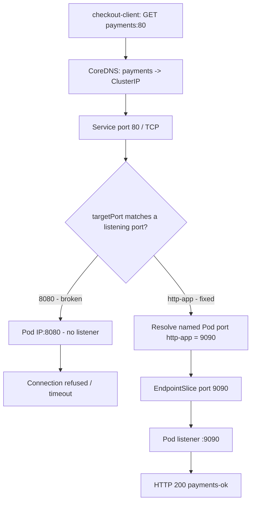

# D5-002 — Service port vs targetPort: checkout timeout dù Pods Ready

**Domain 5 · Cơ bản → trung cấp · 35–45 phút · Namespace:** `ckad-d5-002`.

## Incident thực tế

`checkout-client` gọi `http://payments:80/` để xác nhận thanh toán nhưng timeout/connection refused. Deployment `payments-api` vẫn **2/2 Ready**; Service đã chọn đúng Pod và DNS trả về ClusterIP. Backend chỉ lắng nghe **9090**, trong khi Service đang gửi tới **8080**. Đây là lỗi **port translation**, khác với selector mismatch của D5-001.

### Yêu cầu nghiệm thu

- Giữ nguyên Deployment 2 replicas, nhãn `app=payments-api`, ứng dụng lắng nghe 9090 và readinessProbe.
- Giữ Service ClusterIP tên `payments`, `port: 80`, selector đúng và không dùng NodePort/LoadBalancer/Pod IP.
- Chuyển `targetPort` sang **tên cổng** `http-app` (Pod khai báo `containerPort: 9090`).
- EndpointSlice phản ánh **hai backend Ready** với port **9090**.
- Pod `checkout-client` truy cập `http://payments:80/` trả HTTP 200, body `payments-ok`.

## Mental model: port mapping không phải containerPort binding



**Phân biệt:** `port` là cổng của Service mà client gọi; `targetPort` là cổng đích ở backend. `containerPort` là khai báo metadata, **không tự mở socket**; tiến trình trong container phải thật sự listen trên cổng đó. Dùng `targetPort` theo tên giúp giữ contract Service ổn định khi số cổng của Pod thay đổi.

## Controller flow và request flow

```mermaid
sequenceDiagram
  participant Operator as kubectl
  participant API as API server
  participant ESC as EndpointSlice controller
  participant Slice as EndpointSlice
  participant Proxy as kube-proxy dataplane
  participant DNS as CoreDNS
  participant Client as checkout-client
  participant Backend as payments-api :9090
  Operator->>API: Patch Service targetPort = http-app
  API-->>Operator: Service updated
  ESC-->>API: Watch Service + Ready Pods
  ESC->>API: Reconcile EndpointSlice ports to 9090
  API-->>Slice: Persist desired EndpointSlice
  Proxy-->>API: Watch EndpointSlice changes
  Note over Proxy,Slice: Programming is asynchronous; no per-request API call
  Client->>DNS: Resolve payments.ckad-d5-002.svc.cluster.local
  DNS-->>Client: Service ClusterIP
  Client->>Proxy: TCP request to ClusterIP:80
  Proxy->>Backend: Forward to selected Pod IP:9090
  Backend-->>Client: HTTP 200 payments-ok
```

## Thực hành trên kind

Yêu cầu: Docker, kind, kubectl, Bash, Python 3; có quyền pull image `hashicorp/http-echo:1.0.0` và `busybox:1.36`. Cluster kind riêng, không đụng CKA:

```bash
kind create cluster --name ckad  # chỉ tạo lần đầu; nếu đã có thì bỏ qua
kubectl config use-context kind-ckad
kubectl apply -f setup.yaml
kubectl -n ckad-d5-002 rollout status deploy/payments-api --timeout=180s
kubectl -n ckad-d5-002 wait --for=condition=Ready pod/checkout-client --timeout=180s
kubectl -n ckad-d5-002 get svc payments -o yaml
kubectl -n ckad-d5-002 get pods -l app=payments-api -o wide
kubectl -n ckad-d5-002 get endpointslices -l kubernetes.io/service-name=payments -o yaml
kubectl -n ckad-d5-002 exec checkout-client -- wget -T 5 -O - http://payments:80/
```

**Quan sát trước khi sửa:** DNS và selector đúng nhưng Service endpoint port là 8080; tiến trình backend listen 9090. Lỗi có thể là connection refused hoặc timeout tùy dataplane.

### Bài tập

Không thay Pod spec hoặc dùng IP trực tiếp. Chỉ chỉnh Service `targetPort` để dùng tên cổng `http-app`. Theo dõi EndpointSlice và kiểm tra HTTP từ client.

```bash
bash solution.sh
bash verify.sh
```

`solution.sh` idempotent; `verify.sh` kiểm tra **live Kubernetes state**, bao gồm Service spec, Deployment, Pod Ready, EndpointSlice port và HTTP nội bộ. Controller reconcile có thể trễ tối đa 90 giây trong vòng polling. Verifier không dùng mock.

### Negative test

```bash
bash negative-tests.sh  # cố tình đưa targetPort về 8080; verifier PHẢI fail
bash solution.sh
bash verify.sh
```

Negative test chỉ thay đổi Service trong namespace `ckad-d5-002`. Nếu script không fail khi targetPort sai, grader có bug và phải điều tra.

## Troubleshooting production

| Triệu chứng | Câu lệnh | Ý nghĩa |
|---|---|---|
| Pods Ready, client không kết nối | `kubectl -n ckad-d5-002 get svc payments -o yaml` | So sánh `port` và `targetPort` |
| EndpointSlice có 2 địa chỉ nhưng sai port | `kubectl -n ckad-d5-002 get endpointslices -l kubernetes.io/service-name=payments -o yaml` | Controller phản ánh port đích, không chứng minh socket đang listen |
| HTTP fail từ Pod client | `kubectl -n ckad-d5-002 exec checkout-client -- wget -S -T 5 -O - http://payments:80/` | Test end-to-end qua DNS + Service |
| Service không có endpoints | `kubectl -n ckad-d5-002 get pods --show-labels` | Đây là selector/readiness, quay lại D5-001 |
| Pod không Ready | `kubectl -n ckad-d5-002 describe pod -l app=payments-api` | Kiểm tra image/probe/events |
| targetPort theo tên không resolve | `kubectl -n ckad-d5-002 get deploy payments-api -o yaml` | Tên `http-app` phải khớp container port name |
| HTTP 200 nhưng body sai | `kubectl -n ckad-d5-002 logs deploy/payments-api` | Có thể trỏ nhầm backend hoặc ứng dụng |

**Production note:** Với named targetPort, Kubernetes resolve tên sang port số tương ứng trên từng Pod. EndpointSlice controller công bố endpoint/port, còn kube-proxy hoặc dataplane CNI áp dụng quy tắc chuyển tiếp bất đồng bộ. Không có chuyện kube-proxy đọc EndpointSlice trực tiếp trong từng HTTP request.

## Cleanup

```bash
kubectl delete namespace ckad-d5-002
```

## Tài liệu chính thức

- [Kubernetes Service: port and targetPort](https://kubernetes.io/docs/concepts/services-networking/service/)
- [EndpointSlices](https://kubernetes.io/docs/concepts/services-networking/endpoint-slices/)
- [Debug Services](https://kubernetes.io/docs/tasks/debug/debug-application/debug-service/)
- [DNS for Services](https://kubernetes.io/docs/concepts/services-networking/dns-pod-service/)
- [kind Quick Start](https://kind.sigs.k8s.io/docs/user/quick-start/)
