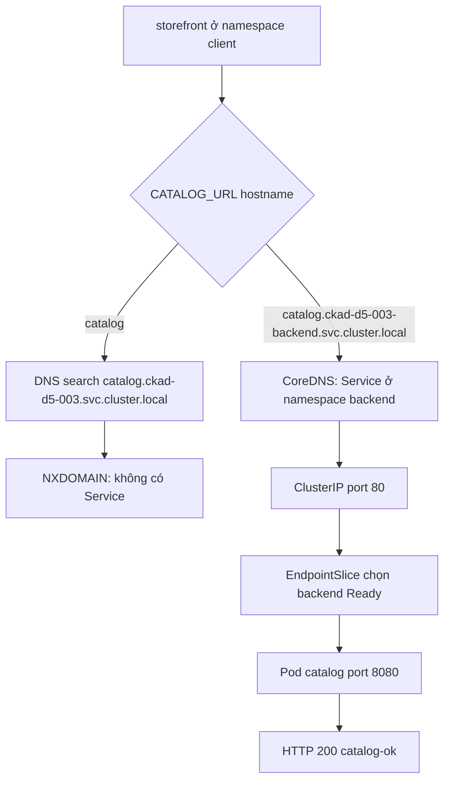

# D5-003 — Cross-namespace DNS: storefront không gọi được catalog

**Domain 5 · 40–50 phút · Namespace cô lập:** `ckad-d5-003` (client), `ckad-d5-003-backend` (server).

## Production incident

Một ứng dụng storefront chuyển sang namespace riêng. Backend catalog vẫn có **hai replicas Ready** và Service ClusterIP port 80. Storefront dùng `http://catalog:80/` và báo `bad address`. Đây là lỗi **DNS search namespace**, không phải selector mismatch (D5-001) hay targetPort mismatch (D5-002).

**Mục tiêu:** client dùng `http://catalog.ckad-d5-003-backend.svc.cluster.local:80/`, vẫn giữ namespace riêng; không hardcode Pod IP, không sửa CoreDNS, không tạo Service cùng tên trong namespace client. Giữ nguyên Service và hai backend Ready. Pod env là immutable, vì vậy phải recreate client.

## Sơ đồ DNS



## Sequence: API/controller flow và request flow

```mermaid
sequenceDiagram
 participant Dev as Developer
 participant API as API server
 participant Kubelet as kubelet
 participant Client as storefront
 participant DNS as CoreDNS
 participant Data as Service dataplane
 participant Backend as catalog
 Dev->>API: Recreate Pod với CATALOG_URL FQDN
 API-->>Kubelet: Pod spec mới
 Kubelet->>Client: Start container với env mới
 Client->>DNS: Lookup catalog.ckad-d5-003-backend.svc.cluster.local
 DNS-->>Client: ClusterIP
 Client->>Data: HTTP GET ClusterIP:80
 Note over Data,Backend: EndpointSlice controller cập nhật endpoints; dataplane reconcile bất đồng bộ
 Data->>Backend: TCP PodIP:8080
 Backend-->>Client: HTTP 200 catalog-ok
```

**Mental model:** Tên ngắn Service mặc định được resolve trong namespace Pod client (qua search domains ở `/etc/resolv.conf`). Tên DNS đầy đủ chỉ rõ namespace đích. CoreDNS trả ClusterIP; EndpointSlice controller theo dõi Service/Pod, dataplane (kube-proxy hoặc CNI) chọn backend. Không có API server call cho từng HTTP request.

## Chuẩn bị và quan sát trên kind

Cần Docker, kind, kubectl, Bash, Python 3; có thể pull `hashicorp/http-echo:1.0.0`, `busybox:1.36`.

```bash
kind create cluster --name ckad  # chỉ lần đầu; không xóa cluster đang dùng
kubectl config use-context kind-ckad
kubectl apply -f setup.yaml
kubectl -n ckad-d5-003-backend rollout status deploy/catalog --timeout=180s
kubectl -n ckad-d5-003 wait --for=condition=Ready pod/storefront --timeout=180s
kubectl -n ckad-d5-003 exec storefront -- cat /etc/resolv.conf
kubectl -n ckad-d5-003 exec storefront -- nslookup catalog
kubectl -n ckad-d5-003 exec storefront -- nslookup catalog.ckad-d5-003-backend.svc.cluster.local
kubectl -n ckad-d5-003-backend get svc catalog
kubectl -n ckad-d5-003-backend get endpointslices -l kubernetes.io/service-name=catalog
```

Trước sửa: lookup `catalog` trong namespace client thất bại; FQDN namespace backend có ClusterIP. Nếu DNS đúng mà HTTP lỗi, kiểm tra Service selector, endpoints và port, không quy mọi lỗi về DNS.

## Thực hành và tự chấm

```bash
bash solution.sh
bash verify.sh
bash negative-tests.sh
bash solution.sh
bash verify.sh
```

`solution.sh` idempotent và recreate client Pod khi cần. `verify.sh` kiểm tra **trạng thái Kubernetes thật** (namespace, Pod env, Deployment 2 Ready, Service contract) và gọi HTTP từ client qua FQDN. `negative-tests.sh` tái tạo lỗi URL tên ngắn, bắt buộc verifier fail; restore bằng solution. Không dùng mock.

## Troubleshooting

| Triệu chứng | Câu lệnh | Ý nghĩa |
|---|---|---|
| bad address catalog | `kubectl -n ckad-d5-003 exec storefront -- cat /etc/resolv.conf` | Search namespace client |
| FQDN NXDOMAIN | `kubectl -n ckad-d5-003-backend get svc catalog` | Sai Service/namespace hoặc CoreDNS |
| DNS OK, HTTP lỗi | `kubectl -n ckad-d5-003-backend get endpointslices -l kubernetes.io/service-name=catalog` | Kiểm tra endpoints/port |
| Pod không Ready | `kubectl -n ckad-d5-003-backend describe pods -l app=catalog` | Image pull/readiness |
| URL vẫn cũ | `kubectl -n ckad-d5-003 exec storefront -- printenv CATALOG_URL` | Pod env immutable, phải recreate |
| DNS toàn cluster lỗi | `kubectl -n kube-system get pods -l k8s-app=kube-dns` | CoreDNS |

## Cleanup

```bash
kubectl delete namespace ckad-d5-003 ckad-d5-003-backend
```

## Tài liệu chính thức

- [DNS for Services and Pods](https://kubernetes.io/docs/concepts/services-networking/dns-pod-service/)
- [Debug DNS](https://kubernetes.io/docs/tasks/administer-cluster/dns-debugging-resolution/)
- [Service](https://kubernetes.io/docs/concepts/services-networking/service/)
- [EndpointSlice](https://kubernetes.io/docs/concepts/services-networking/endpoint-slices/)
- [kind Quick Start](https://kind.sigs.k8s.io/docs/user/quick-start/)
