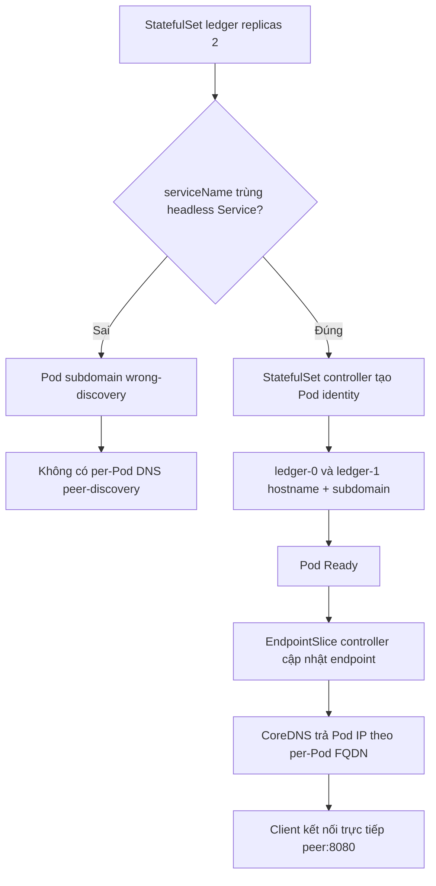
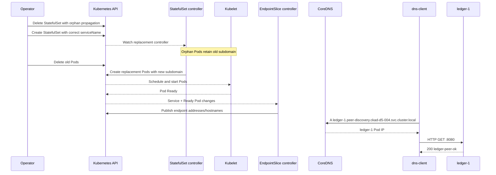

# D5-004 — Headless Service và DNS riêng cho từng Pod StatefulSet

**Domain 5 · 50–65 phút · namespace:** `ckad-d5-004`. Bài này khác D5-001 (selector), D5-002 (targetPort), D5-003 (cross-namespace DNS): tập trung vào **stable Pod identity** và headless Service.

## Sự cố thực tế

Ứng dụng ledger chạy 2 replica theo StatefulSet, mỗi replica cần gọi trực tiếp peer theo hostname cố định, ví dụ `ledger-1.peer-discovery.ckad-d5-004.svc.cluster.local`. Service `peer-discovery` đã có `clusterIP: None`, selector và port đúng, các Pod vẫn Ready, nhưng hostname riêng từng peer không resolve. StatefulSet đang khai báo `serviceName: wrong-discovery`, làm Pod có subdomain sai. Không giải quyết bằng ClusterIP, IP tĩnh hoặc sửa CoreDNS.

**Yêu cầu:** sửa `spec.serviceName` thành `peer-discovery`, bảo đảm hai Pod được tái tạo để nhận hostname/subdomain mới; giữ replicas=2, selector, headless Service và readiness. Kiểm tra DNS và HTTP trực tiếp đến từng Pod, không chỉ kiểm tra trạng thái Ready.

## Flowchart: controller reconciliation và DNS record



## SequenceDiagram: control plane và data plane



**Phân biệt:** Headless Service không cấp virtual ClusterIP; DNS trả địa chỉ Pod đủ điều kiện. Pod-specific DNS phụ thuộc hostname/subdomain và Service cùng tên. `publishNotReadyAddresses: false` khiến peer chưa Ready chưa được publish như endpoint sẵn sàng. API server không nằm trên đường truyền HTTP sau khi DNS hoàn tất.

## Chạy trên kind

Yêu cầu Docker, kind, kubectl, Bash, Python 3; cần pull `hashicorp/http-echo:1.0.0` và `busybox:1.36`. Không tạo lại cluster đang tồn tại.

```bash
kind create cluster --name ckad # bỏ qua nếu đã có
kubectl config use-context kind-ckad
kubectl apply -f setup.yaml
kubectl -n ckad-d5-004 rollout status sts/ledger --timeout=180s
kubectl -n ckad-d5-004 get pods -o wide
kubectl -n ckad-d5-004 get svc peer-discovery -o yaml
kubectl -n ckad-d5-004 get endpointslices -l kubernetes.io/service-name=peer-discovery
kubectl -n ckad-d5-004 get pod ledger-0 -o jsonpath='{.spec.subdomain}'
kubectl -n ckad-d5-004 exec dns-client -- nslookup ledger-0.peer-discovery.ckad-d5-004.svc.cluster.local
```

Quan sát ban đầu: Pod Ready nhưng `subdomain=wrong-discovery`; DNS per-Pod mong muốn không tồn tại. Lưu ý **`StatefulSet.spec.serviceName` là immutable**: `kubectl patch sts` sẽ bị API server từ chối. Phải xóa controller với `--cascade=orphan` rồi tạo lại StatefulSet với `serviceName` đúng, sau đó tái tạo các Pod cũ để nhận subdomain mới. Không xóa Service hoặc namespace.

## Thực hành, đáp án, tự chấm

```bash
bash verify.sh            # phải FAIL trước khi sửa
bash solution.sh          # idempotent, recreate Pod để áp dụng identity
bash verify.sh            # phải PASS
bash negative-tests.sh    # cố ý phá serviceName và recreate; verifier phải FAIL
bash solution.sh          # khôi phục
bash verify.sh            # phải PASS lần nữa
```

`verify.sh` đọc Kubernetes API trực tiếp để kiểm tra StatefulSet, Service, Pod Ready, hostname/subdomain và thực hiện `nslookup` + HTTP từ Pod client đến **cả hai** peer. Không dùng mock. `negative-tests.sh` là destructive trong namespace lab, chủ động tạo lại lỗi và yêu cầu chạy `solution.sh` để phục hồi.

## Troubleshooting

| Triệu chứng | Chẩn đoán | Khắc phục |
|---|---|---|
| StatefulSet serviceName đúng, Pod subdomain vẫn sai | `kubectl -n ckad-d5-004 get pod ledger-0 -o jsonpath='{.spec.subdomain}'` | Recreate Pod |
| NXDOMAIN peer | `kubectl -n ckad-d5-004 get svc peer-discovery -o yaml` | Kiểm tra headless, selector, namespace, tên |
| EndpointSlice không có ready endpoints | `kubectl -n ckad-d5-004 describe pod ledger-1` | Kiểm tra readiness/image |
| DNS có IP nhưng HTTP timeout | `kubectl -n ckad-d5-004 get pod -o wide` | Kiểm tra port 8080, policy và container |
| StatefulSet rollout kẹt | `kubectl -n ckad-d5-004 describe sts ledger` | Xem events và Pod status |
| Toàn bộ cluster không resolve DNS | `kubectl -n kube-system get pods -l k8s-app=kube-dns` | Kiểm tra CoreDNS |

**Cleanup:** `kubectl delete namespace ckad-d5-004` (không xóa kind cluster).

## Tài liệu chính thức

- [StatefulSet: Stable Network ID](https://kubernetes.io/docs/concepts/workloads/controllers/statefulset/)
- [DNS for Services and Pods](https://kubernetes.io/docs/concepts/services-networking/dns-pod-service/)
- [Headless Services](https://kubernetes.io/docs/concepts/services-networking/service/#headless-services)
- [EndpointSlices](https://kubernetes.io/docs/concepts/services-networking/endpoint-slices/)
- [kind Quick Start](https://kind.sigs.k8s.io/docs/user/quick-start/)
