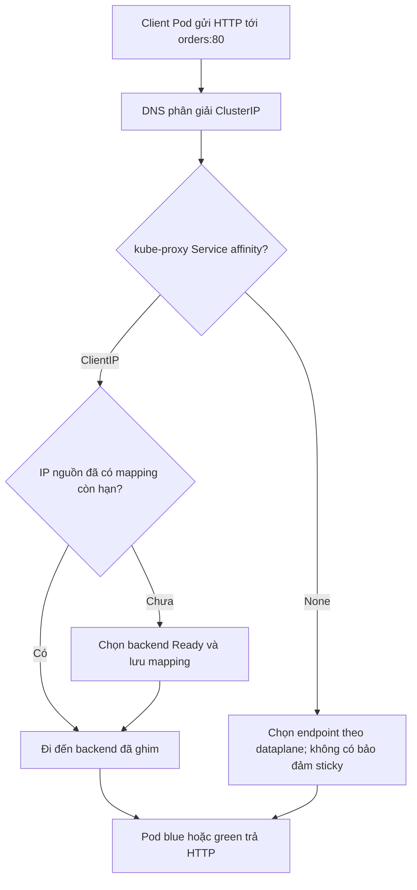
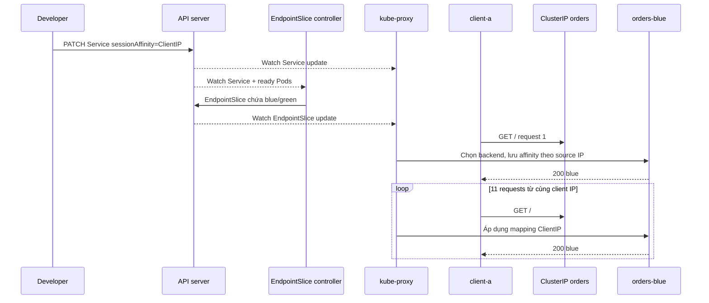

# D5-005 — Session Affinity: giữ client trên cùng backend

**Domain 5 · 45–60 phút · namespace:** `ckad-d5-005`. Khác D5-001 selector, D5-002 targetPort, D5-003 DNS liên namespace, D5-004 DNS từng Pod: bài này kiểm tra **định tuyến nhiều request liên tiếp từ cùng client**.

## Sự cố production

Ứng dụng orders chạy hai phiên bản blue/green có state tạm trong bộ nhớ. Một client gọi API nhiều lần qua Service ClusterIP và đôi khi được điều hướng sang backend khác. Mục tiêu của bài là bật `sessionAffinity: ClientIP` với timeout 10800 giây, giữ nguyên 2 backend Ready, selector và port. Đây chỉ là giải pháp tạm cho ứng dụng legacy: production nên lưu session vào external store (Redis/DB) thay vì phụ thuộc sticky routing.

**Phân biệt:** Service `sessionAffinity: None` không bảo đảm round-robin trên mỗi request; kube-proxy có thể giữ conntrack. Do đó **negative test kiểm tra cấu hình sai một cách tất định**, không dựa vào kỳ vọng các request phải đổi backend. Ngay cả khi cấu hình đúng, kiểm tra HTTP chỉ chứng minh ổn định trong cửa sổ thử nghiệm, không chứng minh mọi tình huống node failover.

## Flowchart: xử lý session theo client IP



## SequenceDiagram: API controller và data plane



**Lưu ý kiến trúc:** ClusterIP là địa chỉ ảo; Service không chạy như một reverse-proxy Pod. Kube-proxy trên node lập quy tắc chuyển tiếp theo implementation của cluster (iptables/nftables/IPVS). API server không xử lý từng HTTP request. NAT/proxy bên ngoài có thể làm nhiều người dùng chia sẻ một IP nguồn.

## Thực hành kind

Yêu cầu Docker, kind, kubectl, Python 3 và Bash. Dùng cluster hiện có hoặc tạo mới:

```bash
kind create cluster --name ckad # nếu chưa có
kubectl config use-context kind-ckad
kubectl apply -f setup.yaml
kubectl -n ckad-d5-005 rollout status deploy/orders-blue --timeout=180s
kubectl -n ckad-d5-005 rollout status deploy/orders-green --timeout=180s
kubectl -n ckad-d5-005 wait --for=condition=Ready pod/client-a pod/client-b --timeout=180s
kubectl -n ckad-d5-005 get svc orders -o yaml
kubectl -n ckad-d5-005 get endpointslices -l kubernetes.io/service-name=orders
kubectl -n ckad-d5-005 exec client-a -- wget -q -O - http://orders/
bash verify.sh         # FAIL vì sessionAffinity=None
bash solution.sh
bash verify.sh         # PASS khi API, endpoints và HTTP đúng
bash negative-tests.sh # Phá cấu hình và xác nhận verifier FAIL
bash solution.sh
bash verify.sh
```

Tự làm: dùng `kubectl patch service orders` hoặc `kubectl edit service orders` để đặt `spec.sessionAffinity=ClientIP` và `spec.sessionAffinityConfig.clientIP.timeoutSeconds=10800`. Không sửa Deployment, Pod, namespace hay image. Script `solution.sh` idempotent.

## Tự chấm và negative tests

`verify.sh` truy vấn API Kubernetes thật, kiểm tra hai Deployment rollout, hai client Ready, đúng Service selector/port/affinity/timeout, EndpointSlice có **hai IP backend Ready**, sau đó thực hiện 12 HTTP requests từ mỗi Pod client và so sánh response theo client. Không dùng mock, không chấm dựa vào grep YAML trên disk. Hai client **không bắt buộc** chọn hai backend khác nhau.

`negative-tests.sh` đặt lại `sessionAffinity=None` và xác nhận verifier trả exit code khác 0. Script cố ý phá bài, cần chạy `solution.sh` để khôi phục.

## Troubleshooting

| Triệu chứng | Cách quan sát | Giải pháp |
|---|---|---|
| verify FAIL Service spec | `kubectl -n ckad-d5-005 get svc orders -o yaml` | Sửa ClientIP và timeout 10800 |
| HTTP không kết nối | `kubectl -n ckad-d5-005 get endpointslices -l kubernetes.io/service-name=orders` | Kiểm tra readiness và port |
| Một backend không Ready | `kubectl -n ckad-d5-005 describe pod -l app=orders` | Kiểm tra image, probes, events |
| Response thay đổi giữa các lần | Kiểm tra IP nguồn, kube-proxy, kết nối, node và timeout | Xác minh NAT/proxy và affinity |
| Cả hai client đều blue | Không phải lỗi: sticky theo client IP, không cân bằng bắt buộc | Không ép client-b sang green |
| DNS lỗi | `kubectl -n ckad-d5-005 exec client-a -- nslookup orders` | Kiểm tra CoreDNS/Service |

**Cleanup:** `kubectl delete namespace ckad-d5-005` — không xóa cluster hoặc lab khác.

## Tài liệu chính thức

- [Kubernetes Service — Session affinity](https://kubernetes.io/docs/reference/networking/virtual-ips/#session-affinity)
- [Service concepts](https://kubernetes.io/docs/concepts/services-networking/service/)
- [EndpointSlices](https://kubernetes.io/docs/concepts/services-networking/endpoint-slices/)
- [kind Quick Start](https://kind.sigs.k8s.io/docs/user/quick-start/)
