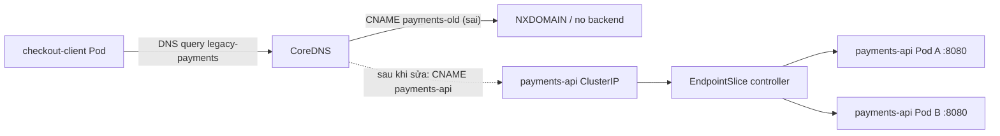
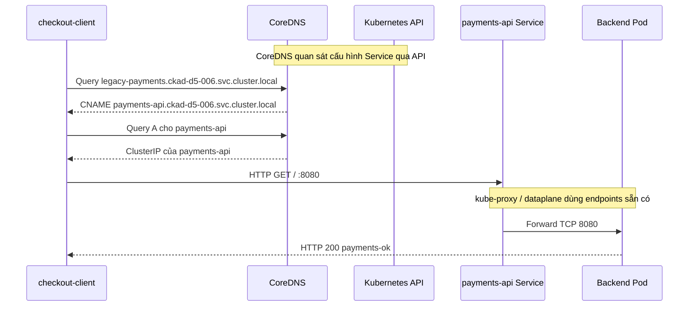

# D5-006 — ExternalName Service: DNS alias cho legacy checkout

**Domain:** Services and Networking · **Mức độ:** Intermediate · **Thời gian:** 20–30 phút · **Namespace:** `ckad-d5-006`

## Bối cảnh production

Đội checkout đang chuyển backend từ `payments-old` sang `payments-api`. Ứng dụng checkout cũ vẫn gọi hostname `legacy-payments`. Thay vì thay đổi mã nguồn và phát hành lại checkout, platform team tạo Kubernetes Service loại `ExternalName` làm DNS alias. Tuy nhiên alias trỏ tới một Service đã bị gỡ, khiến DNS lookup thất bại. Deployment backend vẫn Ready 2/2 và Service backend vẫn hoạt động bình thường.

**Nhiệm vụ:** Giữ nguyên `legacy-payments` là ExternalName, sửa `spec.externalName` thành `payments-api.ckad-d5-006.svc.cluster.local`. Không đổi backend Deployment, không sửa client, không thay ExternalName thành ClusterIP.

## Kiến thức cần hiểu

- `ClusterIP`: Service có virtual IP, selector/EndpointSlice dùng để định tuyến đến Pod.
- `ExternalName`: CoreDNS trả về DNS **CNAME**, không tạo proxy, không cấp ClusterIP và không tự quản lý EndpointSlice cho alias.
- DNS alias chỉ thay đổi tên được phân giải; client vẫn phải kết nối đúng **port 8080**. Với HTTP Host header/TLS SNI, alias có thể cần cấu hình ứng dụng hoặc certificate phù hợp.
- CNAME tới tên Service nội bộ vẫn dùng được; không bắt buộc trỏ Internet. ExternalName không hỗ trợ mọi giao thức/client như nhau.

## Kiến trúc và luồng lỗi



Lưu ý: EndpointSlice controller quản lý endpoint của **payments-api**, không quản lý endpoint của ExternalName. CoreDNS trả về CNAME, DNS resolver tiếp tục phân giải tên đích để lấy IP.



## Chuẩn bị trên kind

Cần Docker, kind, kubectl và cluster có CoreDNS hoạt động. Nếu chưa có cluster:

```bash
kind create cluster --name ckad
kubectl cluster-info --context kind-ckad
```

Không dùng cluster production. Từ thư mục lab:

```bash
kubectl apply -f setup.yaml
kubectl -n ckad-d5-006 rollout status deployment/payments-api --timeout=120s
kubectl -n ckad-d5-006 wait --for=condition=Ready pod/checkout-client --timeout=120s
kubectl -n ckad-d5-006 get pods,svc,endpointslices
```

## Khám phá lỗi (trước khi sửa)

```bash
kubectl -n ckad-d5-006 get svc legacy-payments -o yaml
kubectl -n ckad-d5-006 exec checkout-client -- nslookup legacy-payments.ckad-d5-006.svc.cluster.local
kubectl -n ckad-d5-006 exec checkout-client -- wget -qO- -T 5 http://payments-api:8080/
./verify.sh
```

Lệnh truy cập trực tiếp backend phải trả `payments-ok`; alias cũ phải thất bại. `verify.sh` cố ý FAIL ở trạng thái ban đầu.

## Tự giải

Dùng `kubectl edit svc legacy-payments -n ckad-d5-006` hoặc patch trường `spec.externalName`. Sau đó chạy:

```bash
./verify.sh
```

Nếu cần đáp án mẫu:

```bash
./solution.sh
./verify.sh
```

Grader kiểm tra trạng thái Kubernetes thực: namespace, Deployment Ready, Pod client Ready, loại Service, exact target FQDN, ít nhất 2 endpoint Ready, DNS query và HTTP response qua alias. Không chỉ grep YAML.

## Negative test

```bash
./negative-tests.sh
./verify.sh
```

Negative test yêu cầu baseline PASS, cố ý patch alias sang tên không tồn tại, xác nhận grader FAIL, rồi khôi phục target cũ bằng EXIT trap. Không chạy song song với người đang chỉnh Service.

## Troubleshooting thực tế

| Triệu chứng | Kiểm tra | Giải thích / hướng xử lý |
|---|---|---|
| `NXDOMAIN` | `nslookup legacy-payments...` | CNAME trỏ tới Service không tồn tại |
| `Connection refused` | `kubectl get endpointslice -l kubernetes.io/service-name=payments-api` | Kiểm tra backend và port 8080 |
| DNS đúng nhưng HTTP sai | `wget -qO- http://legacy-payments...:8080/` | ExternalName không tự chuyển port |
| HTTPS certificate mismatch | Kiểm tra SNI và SAN certificate | DNS CNAME không thay hostname ứng dụng |
| Pod chưa Ready | `kubectl describe pod`, `kubectl logs deploy/payments-api` | Image pull, readiness probe, startup |

## Dọn dẹp

```bash
kubectl delete namespace ckad-d5-006
```

Chỉ xóa namespace của lab, không `kind delete cluster` và không ảnh hưởng các lab khác.

## Tài liệu chính thức

- [Kubernetes Service — ExternalName](https://kubernetes.io/docs/concepts/services-networking/service/#externalname)
- [DNS for Services and Pods](https://kubernetes.io/docs/concepts/services-networking/dns-pod-service/)
- [EndpointSlices](https://kubernetes.io/docs/concepts/services-networking/endpoint-slices/)
- [Debug Services](https://kubernetes.io/docs/tasks/debug/debug-application/debug-service/)
