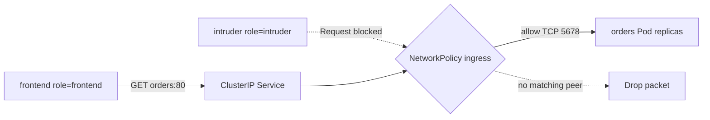
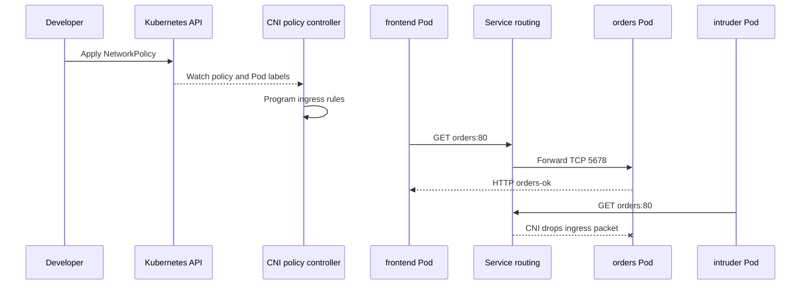

# D5-007 — NetworkPolicy ingress: frontend được phép, intruder bị chặn

**Domain 5 / Services and Networking · Intermediate · Namespace: `ckad-d5-007`**

## Tình huống production
Orders API phục vụ giao dịch nội bộ. Hai replicas đều Ready, Service `orders:80` chuyển tới container port `5678`. Security yêu cầu chỉ Pod `role=frontend` được gọi API; Pod `role=intruder` không được truy cập. Manifest ban đầu tạo NetworkPolicy với `ingress: []`: mọi request tới backend đều bị từ chối khi CNI thực thi policy. Hãy sửa **chỉ** NetworkPolicy, không thay đổi Service, Pod labels hoặc Deployment.

## Chuẩn bị trên kind
Cần Docker, kind, kubectl, bash, python3. **Lưu ý quan trọng:** kindnet mặc định không thực thi NetworkPolicy; cài CNI hỗ trợ (ví dụ Calico) theo tài liệu chính thức trước khi thực hành. Đừng nhầm việc API chấp nhận NetworkPolicy với việc dataplane đã chặn traffic.

```bash
kind create cluster --name ckad-network
kubectl config use-context kind-ckad-network
# Cài CNI hỗ trợ NetworkPolicy theo hướng dẫn tương thích với cluster.
kubectl apply -f setup.yaml
kubectl -n ckad-d5-007 rollout status deployment/orders --timeout=120s
kubectl -n ckad-d5-007 wait --for=condition=Ready pod/frontend pod/intruder --timeout=120s
kubectl -n ckad-d5-007 get networkpolicy orders-ingress -o yaml
```

## Luồng dữ liệu và controller





NetworkPolicy được CNI thực thi, không phải API server hay kube-proxy. `ports.port` phải khớp **destination port của Pod (5678)**, không phải Service port 80.

## Bài tập
Thiết lập `orders-ingress` với `podSelector app=orders`, `policyTypes: [Ingress]`, một ingress rule duy nhất từ `podSelector role=frontend`, port TCP/5678. Không sử dụng `ipBlock`, `namespaceSelector` hoặc allow-all.

```bash
kubectl -n ckad-d5-007 edit networkpolicy orders-ingress
bash verify.sh       # FAIL trước khi sửa
bash solution.sh     # đáp án tham khảo
bash verify.sh       # chỉ PASS khi traffic thực đúng
bash negative-tests.sh
```

`verify.sh` kiểm tra cấu trúc policy bằng Kubernetes API và gọi HTTP thật từ cả frontend lẫn intruder. Negative test đổi peer sang intruder, yêu cầu grader FAIL, rồi khôi phục đáp án bằng trap. Không chạy hai test song song.

## Troubleshooting
- **Cả hai client đều gọi được:** CNI không hỗ trợ hoặc không thực thi NetworkPolicy. Kiểm tra daemonset CNI, Pod logs, trạng thái cluster. Không công nhận PASS.
- **Cả hai đều timeout:** vẫn deny-all hoặc backend chưa Ready. Kiểm tra `kubectl -n ckad-d5-007 get pods,svc,endpointslices,networkpolicy`.
- **frontend timeout nhưng intruder bị chặn:** so sánh labels, `from.podSelector` và TCP/5678.
- **DNS không phân giải:** kiểm tra CoreDNS và `kubectl exec frontend -- nslookup orders` nếu image hỗ trợ; lab chỉ đặt ingress policy lên backend.
- **Negative test lỗi:** xem `bash -x negative-tests.sh`, phân biệt lỗi cluster với grader từ chối chính sách sai.

## Dọn dẹp
```bash
kubectl delete namespace ckad-d5-007
```

## Tài liệu chính thức
- https://kubernetes.io/docs/concepts/services-networking/network-policies/
- https://kubernetes.io/docs/concepts/services-networking/service/
- https://kind.sigs.k8s.io/docs/user/configuration/#networking
- https://docs.tigera.io/calico/latest/getting-started/kubernetes/kind
