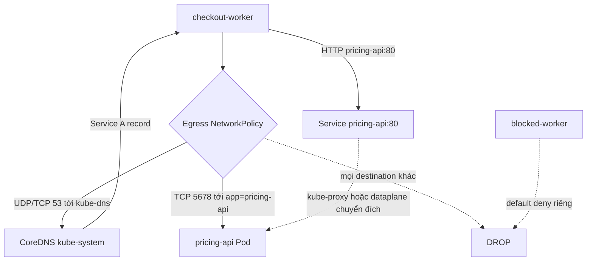
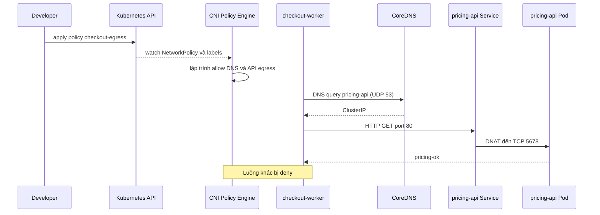

# D5-008 — NetworkPolicy egress: cho phép API và CoreDNS, chặn đường ra khác

**Domain 5 · Services and Networking · Intermediate → Advanced · Namespace:** `ckad-d5-008`

## Sự cố production và mục tiêu

Một `checkout-worker` cần gọi `pricing-api` qua Service DNS nội bộ. Sau khi đội bảo mật áp dụng chính sách **default deny egress**, Pod vẫn Running/Ready nhưng `curl http://pricing-api:80` thất bại: DNS query tới CoreDNS bị chặn trước cả khi kết nối TCP được thiết lập. Yêu cầu khôi phục đúng **hai luồng**: DNS UDP/TCP 53 tới CoreDNS trong `kube-system` và TCP 5678 tới Pod `app=pricing-api` trong namespace hiện tại. Mọi luồng khác tiếp tục bị từ chối. Không xóa policy, không thay labels, không dùng `ipBlock 0.0.0.0/0`.

### Điều kiện chạy thật trên kind

Docker, kind, kubectl, bash và Python 3. **kindnet mặc định không thực thi NetworkPolicy**: phải khởi tạo kind với `disableDefaultCNI: true`, cài Calico tương thích phiên bản Kubernetes trước khi apply lab. Tham khảo [hướng dẫn Calico cho kind](https://docs.tigera.io/calico/latest/getting-started/kubernetes/kind); đợi các node và CoreDNS Ready. Không được coi API chấp nhận NetworkPolicy là bằng chứng dataplane đã hoạt động.

```bash
kind create cluster --name ckad-netpol --config kind-config.yaml
# Cài Calico theo hướng dẫn chính thức; chờ node Ready và CoreDNS Running.
kubectl get nodes
kubectl -n kube-system get pods -l k8s-app=kube-dns --show-labels
kubectl apply -f setup.yaml
kubectl -n ckad-d5-008 rollout status deploy/pricing-api --timeout=180s
kubectl -n ckad-d5-008 wait --for=condition=Ready pod/checkout-worker pod/blocked-worker --timeout=180s
bash verify.sh   # FAIL trước khi giải bài
```

`kind-config.yaml` chỉ định cấu hình mạng kind; không tạo namespace ngoài lab trừ CNI hệ thống. Nếu đã có cluster kind với CNI hỗ trợ NetworkPolicy, có thể dùng cluster đó.

## Luồng controller và request





**Phân biệt:** NetworkPolicy egress chọn **source Pod** qua `spec.podSelector`. `to.podSelector` chọn **destination Pod**, `namespaceSelector` chọn namespace đích. Khi cùng một phần tử `to` có cả namespaceSelector và podSelector, chúng được AND; hai phần tử `to` riêng là OR. Egress port cho HTTP là **destination Pod port 5678**, không phải Service port 80. DNS thường dùng UDP/53, nhưng TCP/53 cần thiết cho một số truy vấn.

## Bài tập và tiêu chí chấm

1. Quan sát `kubectl -n ckad-d5-008 get networkpolicy checkout-egress -o yaml` và các Pod labels.
2. Chỉ sửa `checkout-egress`: chọn `app=checkout-worker`, policyTypes Egress, cho phép DNS UDP/TCP 53 tới Pod `k8s-app=kube-dns` trong namespace `kube-system`, và TCP 5678 tới `app=pricing-api` cùng namespace.
3. Chạy `bash verify.sh`. Grader yêu cầu chính sách least-privilege đúng **và** HTTP thật từ checkout thành công; `blocked-worker` phải bị chặn.
4. Chạy `bash negative-tests.sh` để chứng minh bỏ DNS permission sẽ khiến grader FAIL; script khôi phục trạng thái bằng trap.

```bash
kubectl -n ckad-d5-008 edit networkpolicy checkout-egress
bash solution.sh
bash verify.sh
bash negative-tests.sh
```

## Troubleshooting thực tế

| Triệu chứng | Lệnh kiểm tra | Diễn giải |
|---|---|---|
| DNS timeout | `kubectl -n kube-system get pods -l k8s-app=kube-dns` | DNS egress bị deny, selector không khớp hoặc CoreDNS chưa Ready |
| DNS OK nhưng HTTP timeout | `kubectl -n ckad-d5-008 get endpointslices -l kubernetes.io/service-name=pricing-api` | Sai destination port, selector, hoặc backend chưa Ready |
| blocked-worker gọi được | `kubectl -n ckad-d5-008 get netpol` | CNI không thực thi policy hoặc default deny sai |
| policy hợp lệ nhưng traffic FAIL | `kubectl get pods -A` | Kiểm tra CNI, DNS và Pod readiness trước khi kết luận |
| Service port 80 được allow nhưng HTTP vẫn FAIL | `kubectl -n ckad-d5-008 get svc pricing-api -o yaml` | Egress tới Pod dùng TCP 5678, không phải port 80 |

**Giới hạn kiểm thử:** NetworkPolicy xử lý Pod traffic theo CNI; việc DNAT Service và thứ tự áp policy tùy dataplane. Lab được thiết kế cho Calico trên kind. Không giả định egress isolation áp dụng cho traffic từ node hoặc hostNetwork.

## Dọn dẹp

```bash
kubectl delete namespace ckad-d5-008
# Chỉ xóa cluster nếu do bạn tạo riêng cho lab: kind delete cluster --name ckad-netpol
```

## Tài liệu chính thức

- https://kubernetes.io/docs/concepts/services-networking/network-policies/
- https://kubernetes.io/docs/concepts/services-networking/dns-pod-service/
- https://kubernetes.io/docs/concepts/services-networking/service/
- https://kind.sigs.k8s.io/docs/user/configuration/#disable-default-cni
- https://docs.tigera.io/calico/latest/getting-started/kubernetes/kind
