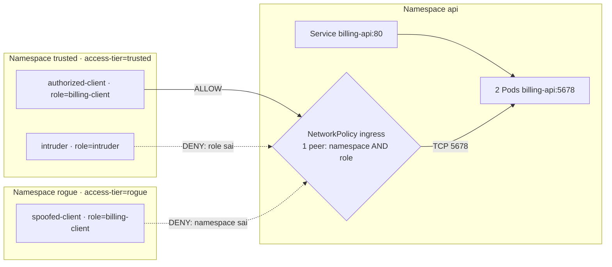
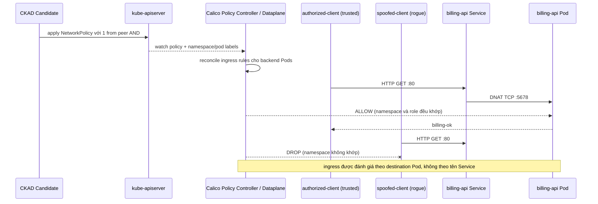

# D5-009 — NetworkPolicy: namespaceSelector AND podSelector (cross-namespace isolation)

**Domain 5 · Services and Networking · Advanced · Namespace cô lập:** `ckad-d5-009-api`, `ckad-d5-009-trusted`, `ckad-d5-009-rogue`.

## 1. Tình huống production

Billing API phục vụ hai replica phía sau ClusterIP. Đội platform muốn **chỉ** cho Pod có nhãn `role=billing-client` **trong namespace** `access-tier=trusted` gọi TCP/5678. Một thay đổi tưởng đúng đã viết hai phần tử `from` riêng: một namespaceSelector, một podSelector. Kubernetes hiểu là **OR**, dẫn đến hai lỗ hổng: Pod `intruder` trong trusted namespace có thể vào; Pod `spoofed-client` ở rogue namespace giả nhãn role cũng có thể vào.

**Mục tiêu:** thay hai peer thành **một peer chứa cả namespaceSelector và podSelector** (AND), vẫn giữ Service và Deployment; không mở wildcard namespace, không cho phép tất cả ports, không thay nhãn để gian lận. Kiểm chứng từ ba Pod thật.

## 2. Chuẩn bị kind có NetworkPolicy enforcement

Cần Docker, kind, kubectl, bash, python3 và CNI hỗ trợ NetworkPolicy. **kindnet mặc định không thực thi NetworkPolicy.** File `kind-config.yaml` tắt default CNI để cài Calico. Theo [hướng dẫn Calico chính thức cho kind](https://docs.tigera.io/calico/latest/getting-started/kubernetes/kind), cài bản Calico phù hợp Kubernetes và đợi node, CoreDNS Ready **trước** khi tạo lab. Không tự coi việc `kubectl apply` thành công là đã có enforcement.

```bash
kind create cluster --name ckad-netpol --config kind-config.yaml
# Cài Calico theo tài liệu chính thức, chờ tất cả nodes và CoreDNS Ready:
kubectl get nodes
kubectl -n kube-system get pods -l k8s-app=kube-dns
kubectl apply -f setup.yaml
kubectl -n ckad-d5-009-api rollout status deploy/billing-api --timeout=180s
kubectl -n ckad-d5-009-trusted wait --for=condition=Ready pod/authorized-client pod/intruder --timeout=180s
kubectl -n ckad-d5-009-rogue wait --for=condition=Ready pod/spoofed-client --timeout=180s
bash verify.sh  # FAIL trước khi sửa
```

Không chạy lab trên cluster đang dùng cho workload khác nếu chưa kiểm tra CNI. Ba namespace chỉ phục vụ bài này; không ảnh hưởng các namespace CKAD cũ.

## 3. Sơ đồ phân quyền — OR khác AND





### Nguyên lý quan trọng

- **Nhiều phần tử `from` = OR:** `- namespaceSelector` và `- podSelector` cho phép hai tập nguồn độc lập.
- **Cùng một phần tử `from` = AND:** `namespaceSelector` và `podSelector` phải đồng thời khớp.
- `podSelector` đơn lẻ trong ingress peer chọn Pod **cùng namespace với NetworkPolicy**, không tự động chọn Pod từ mọi namespace.
- `spec.podSelector` của policy chọn **destination Pods** cần bảo vệ. `from` chọn source.
- Port 5678 là port của destination Pod, không phải Service port 80. CNI quyết định chính sách tại Pod/dataplane, có thể khác nhau về thứ tự DNAT.
- NetworkPolicy là **additive allow**: các policy khác chọn cùng Pod có thể mở thêm traffic; lab không tạo policy ingress khác.

## 4. Thực hành và tự chấm

```bash
kubectl -n ckad-d5-009-api get networkpolicy billing-ingress -o yaml
kubectl get ns --show-labels
kubectl -n ckad-d5-009-trusted get pods --show-labels
kubectl -n ckad-d5-009-rogue get pods --show-labels
# Tự edit ingress.from thành một phần tử chứa cả hai selector:
kubectl -n ckad-d5-009-api edit networkpolicy billing-ingress
# Hoặc xem đáp án:
bash solution.sh
bash verify.sh
bash negative-tests.sh
```

`verify.sh` kiểm tra selectors, port, labels, Deployment Ready và **HTTP thật** qua ClusterIP từ cả ba Pod: authorized phải trả `billing-ok`, intruder và spoofed-client phải timeout/deny. Nếu CNI không enforce, negative traffic sẽ thành công và grader FAIL. `negative-tests.sh` cố ý đổi AND thành OR, xác nhận grader từ chối rồi phục hồi solution bằng EXIT trap. Test có timeout và có thể mất vài giây để policy hội tụ.

## 5. Troubleshooting

| Triệu chứng | Lệnh | Nguyên nhân / hướng xử lý |
|---|---|---|
| Tất cả Pod truy cập được | `kubectl get pods -A` | CNI chưa cài, kindnet vẫn chạy hoặc có policy allow khác |
| Authorized timeout | `kubectl get ns --show-labels` | Sai namespace label, sai role, Calico chưa Ready |
| Service không có backend | `kubectl -n ckad-d5-009-api get endpointslices -l kubernetes.io/service-name=billing-api` | Pod chưa Ready hoặc Service selector sai |
| Policy nhìn đúng nhưng intruder vào | `kubectl -n ckad-d5-009-api get netpol -o yaml` | Hai phần tử `from` riêng (OR), policy khác mở thêm ingress |
| Curl DNS lỗi | `kubectl -n kube-system get pods -l k8s-app=kube-dns` | DNS/CNI chưa ổn; grader dùng Service ClusterIP để cô lập lỗi ingress |
| Image pull fail | `kubectl describe pod -n ckad-d5-009-trusted authorized-client` | Kiểm tra mạng Docker registry và image availability |

**Negative test bổ sung thủ công:** sau khi sửa, đổi label namespace rogue thành trusted và thử lại: spoofed-client lúc đó sẽ được allow theo đúng chính sách. Phục hồi label ngay sau test. Điều này chứng minh namespace labels là một phần trust boundary và phải được quản lý bằng RBAC.

## 6. Cleanup

```bash
kubectl delete namespace ckad-d5-009-api ckad-d5-009-trusted ckad-d5-009-rogue
# Chỉ xóa kind cluster nếu cluster được tạo riêng cho lab:
kind delete cluster --name ckad-netpol
```

## 7. Tài liệu chính thức

- https://kubernetes.io/docs/concepts/services-networking/network-policies/
- https://kubernetes.io/docs/concepts/services-networking/service/
- https://kubernetes.io/docs/concepts/services-networking/dns-pod-service/
- https://kind.sigs.k8s.io/docs/user/configuration/#disable-default-cni
- https://docs.tigera.io/calico/latest/getting-started/kubernetes/kind

**Lưu ý:** chưa có bằng chứng end-to-end nếu chưa thực sự chạy trên kind + Calico; không được ghi PASS chỉ vì YAML hợp lệ.
