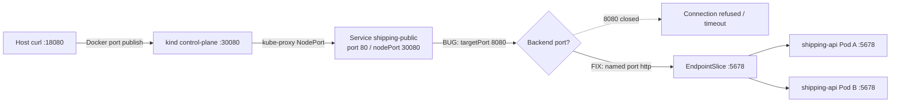
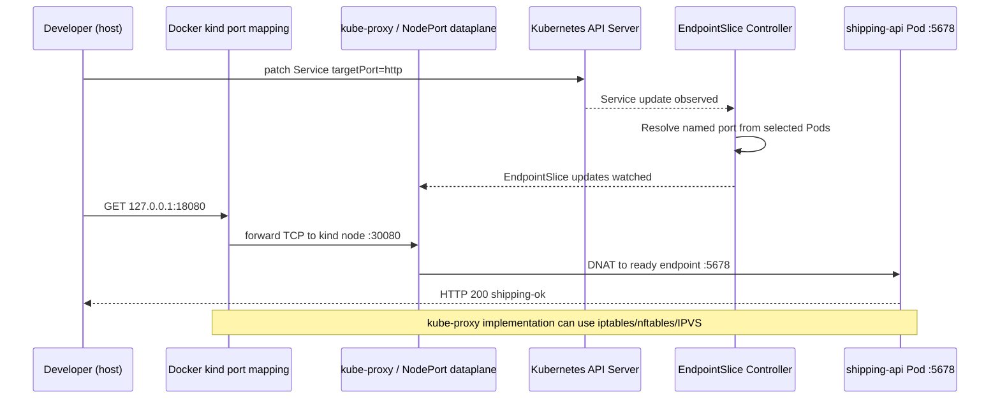

# D5-010 — NodePort qua kind: Service đúng nhưng host không gọi được API

**Domain 5 — Services and Networking · Intermediate · Namespace:** `ckad-d5-010`

## 1. Tình huống production và mục tiêu

Đội shipping cần mở HTTP API cho một hệ thống chạy ngoài cluster. Hai replica `shipping-api` đều Ready; Service `shipping-public` có NodePort 30080, nhưng `curl` từ máy host thất bại. Kỹ sư dễ nhầm đây là lỗi Docker port mapping, kube-proxy hoặc Pod readiness. Trong bài này lỗi thực sự là Service `targetPort: 8080`, trong khi container lắng nghe **5678** và khai báo named port `http`.

Khác với D5-002 (ClusterIP nội bộ), bài này yêu cầu quan sát **hai tầng forwarding**: `127.0.0.1:18080` của host → kind control-plane container `:30080` → NodePort Service → backend Pod `:5678`. Không sửa container port, không đổi nodePort, không tạo Ingress. Namespace và kind cluster dành riêng cho lab.

## 2. Chuẩn bị và baseline FAIL

Yêu cầu: Docker Engine đang chạy, kind, kubectl, bash, python3, curl; port 18080 trên host còn trống. Tránh chạy trên cluster production. `kind-config.yaml` ánh xạ hostPort 18080 → containerPort 30080 trên control-plane. **Phải tạo cluster với config trước khi chạy setup**; sửa config sau khi tạo không tự cập nhật Docker port mapping.

```bash
kind create cluster --name ckad-d5-010 --config kind-config.yaml
kubectl config use-context kind-ckad-d5-010
kubectl apply -f setup.yaml
kubectl -n ckad-d5-010 rollout status deploy/shipping-api --timeout=180s
kubectl -n ckad-d5-010 get pods -o wide
kubectl -n ckad-d5-010 get svc shipping-public -o yaml
curl --max-time 3 -v http://127.0.0.1:18080/ # thất bại trước sửa
bash verify.sh # phải FAIL
```

## 3. Topology: port mapping không phải targetPort





**Lưu ý controller:** API Server lưu Service/EndpointSlice; EndpointSlice controller tạo endpoint từ Service selector, Pod labels và readiness. kube-proxy theo dõi Service/EndpointSlice để cập nhật forwarding rules. Docker port publishing ở ngoài Kubernetes. NodePort `30080` thuộc dải mặc định `30000–32767`; Service `port: 80` dành cho client bên trong cluster. Named targetPort `http` được ánh xạ tới `containerPort: 5678` trên Pod.

## 4. Chẩn đoán từng lớp và sửa lỗi

```bash
# 1. Kiểm tra Pod / Service / EndpointSlice
kubectl -n ckad-d5-010 get deploy,pod,svc,endpointslice -o wide
kubectl -n ckad-d5-010 describe svc shipping-public
kubectl -n ckad-d5-010 get endpointslices -l kubernetes.io/service-name=shipping-public -o yaml
# 2. Kiểm tra Docker mapping của node control-plane
docker port ckad-d5-010-control-plane 30080/tcp
# 3. Xác định targetPort và containerPort khác nhau
kubectl -n ckad-d5-010 get svc shipping-public -o jsonpath='{.spec.ports[0].targetPort}{"\n"}'
kubectl -n ckad-d5-010 get deploy shipping-api -o jsonpath='{.spec.template.spec.containers[0].ports[0].containerPort}{"\n"}'
# 4. Sửa bằng kubectl edit hoặc chạy đáp án
kubectl -n ckad-d5-010 edit service shipping-public
bash solution.sh
# 5. Chấm bằng trạng thái thật
bash verify.sh
bash negative-tests.sh
```

Đáp án thay `targetPort` bằng named port `http` nhưng giữ nguyên `port:80` và `nodePort:30080`. `verify.sh` xác nhận Service, hai endpoint Ready, port EndpointSlice = 5678 và HTTP thực tế từ **host** qua 18080; không chỉ so sánh manifest. `negative-tests.sh` cố tình làm hỏng targetPort rồi đòi verifier phải FAIL; trap phục hồi đáp án khi script kết thúc.

## 5. Troubleshooting / phản ví dụ

| Triệu chứng | Kiểm tra | Hướng xử lý |
|---|---|---|
| Docker không chạy | `docker info` | Khởi động Docker trước khi tạo kind |
| Host port bị chiếm | `ss -ltn '( sport = :18080 )'` | Giải phóng port, tạo lại kind; không sửa mapping tùy tiện |
| NodePort không tới Pod | `kubectl get svc -n ckad-d5-010 -o yaml` | Đối chiếu targetPort với port container |
| EndpointSlice không có ready endpoints | `kubectl get endpointslices -n ckad-d5-010 -o yaml` | Kiểm tra labels và readiness probe |
| EndpointSlice port = 8080 | `kubectl describe svc -n ckad-d5-010 shipping-public` | Sửa named targetPort `http` |
| Service đúng nhưng host vẫn lỗi | `docker port ckad-d5-010-control-plane` | Kiểm tra mapping host:18080 → node:30080 và context |
| HTTP không đúng body | `curl -v http://127.0.0.1:18080/` | Kiểm tra backend response và port |

**Negative test mở rộng:** thay selector Service thành `app=missing`, EndpointSlice không có endpoint Ready và grader phải FAIL; phục hồi selector. Đổi Service sang ClusterIP, grader cũng phải FAIL vì NodePort không tồn tại. Chỉ thử trên namespace lab.

## 6. Cleanup

```bash
kubectl delete namespace ckad-d5-010
kind delete cluster --name ckad-d5-010
```

## 7. Tài liệu chính thức

- [Kubernetes Service và NodePort](https://kubernetes.io/docs/concepts/services-networking/service/#type-nodeport)
- [Kubernetes EndpointSlices](https://kubernetes.io/docs/concepts/services-networking/endpoint-slices/)
- [kind extraPortMappings](https://kind.sigs.k8s.io/docs/user/configuration/#extra-port-mappings)
- [Kubernetes Debug Services](https://kubernetes.io/docs/tasks/debug/debug-application/debug-service/)

**Giới hạn:** Có script chạy trên kind thật, nhưng chưa tuyên bố end-to-end PASS khi chưa thực thi trên Docker/kind.
