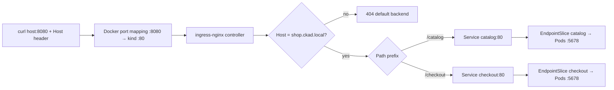
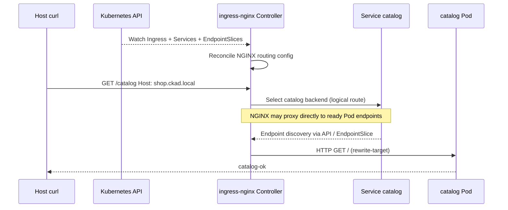

# D5-011 — Ingress Host + Path Routing: sai backend dù Pod Ready

**Domain 5 · Services and Networking · CKAD · Mức độ: intermediate**

## Triệu chứng production
Một shop expose `shop.ckad.local/catalog` và `/checkout`. Deployment catalog/checkout đều 2/2 Ready; Service và EndpointSlice đều khỏe. Tuy nhiên `/catalog` trả `checkout-ok`, còn `/checkout` trả `catalog-ok`. Đây là lỗi **Ingress backend mapping**, không phải DNS Pod, Service selector hay targetPort (đã học ở D5-001..D5-003).

## Mục tiêu
- Đọc `Ingress.spec.rules[].http.paths[].backend.service.name`, phân biệt Host header, Prefix path và Service.
- Sửa hai backend **không thay đổi Deployment/Service**.
- Kiểm chứng HTTP đi qua ingress controller thực tế, không chỉ grep YAML.
- Negative test: cố tình tráo một backend, grader phải FAIL.

## Luồng kiến trúc


## Controller / request sequence


## Prerequisites (kind + ingress-nginx)
Yêu cầu Docker, kind, kubectl, curl, node (cho grader) và internet để tải image/controller. Dùng cluster riêng để không đụng các lab khác:

```bash
kind create cluster --name ckad-d5-011 --config kind-config.yaml
kubectl config use-context kind-ckad-d5-011
kubectl apply -f https://raw.githubusercontent.com/kubernetes/ingress-nginx/controller-v1.12.1/deploy/static/provider/kind/deploy.yaml
kubectl -n ingress-nginx rollout status deployment/ingress-nginx-controller --timeout=300s
kubectl apply -f setup.yaml
kubectl -n ckad-d5-011 rollout status deployment/catalog --timeout=180s
kubectl -n ckad-d5-011 rollout status deployment/checkout --timeout=180s
```

**Lưu ý:** ingress-nginx bản trên là một ví dụ pin phiên bản cho lab, không phải khuyến nghị production. Nếu image không tương thích Kubernetes/kind đang dùng, phải chọn phiên bản tương thích và ghi lại phiên bản đã chạy; không tự nhận PASS.

## Quan sát lỗi trước khi sửa
```bash
kubectl -n ckad-d5-011 get ingress storefront -o yaml
kubectl -n ckad-d5-011 get svc,endpointslice,pods -o wide
curl -sS -H 'Host: shop.ckad.local' http://127.0.0.1:8080/catalog
curl -sS -H 'Host: shop.ckad.local' http://127.0.0.1:8080/checkout
```

Expected *broken*: `/catalog → checkout-ok`, `/checkout → catalog-ok`. Không dùng `curl localhost:80`: host port mapping là 8080.

## Nhiệm vụ
1. Kiểm tra IngressClass `nginx` và host `shop.ckad.local`.
2. Sửa backend `/catalog → catalog:80`, `/checkout → checkout:80`.
3. Giữ nguyên Prefix và rewrite-target `/` vì `http-echo` trả response tại root.
4. Kiểm tra cả đường hợp lệ và Host sai (404). **Đừng chỉ dựa vào Ready Pod**.

## Đáp án / tự chấm
```bash
bash solution.sh
bash verify.sh
bash negative-tests.sh
```

`verify.sh` kiểm tra namespace, controller rollout, hai Deployment, ready EndpointSlice, Ingress spec, HTTP thực từ host và Host sai. Negative test chủ động phá một route, xác nhận grader bắt lỗi, sau đó restore. **Chỉ chạy negative test trên cluster lab**. Nếu script dừng giữa chừng, chạy lại `solution.sh` để khôi phục.

## Troubleshooting
| Hiện tượng | Nguyên nhân khả dĩ | Lệnh kiểm tra |
|---|---|---|
| Connection refused :8080 | Cluster không có extraPortMappings hoặc controller chưa Ready | `docker ps`, `kubectl -n ingress-nginx get pods` |
| 404 cả hai path | Host header sai, ingressClass sai, controller chưa sync | `kubectl describe ingress -n ckad-d5-011 storefront` |
| 503 | Service thiếu ready endpoint hoặc Pod chưa Ready | `kubectl -n ckad-d5-011 get endpointslice` |
| Trả nhầm body | Hai backend bị tráo | `kubectl -n ckad-d5-011 get ingress storefront -o yaml` |
| curl chạy trong container khác | 127.0.0.1 không phải host Docker | Chạy curl trên máy host |

## Dọn dẹp
```bash
kind delete cluster --name ckad-d5-011
```
Không xóa cluster chung, namespace hoặc volume của lab khác.

## Tài liệu chính thức
- [Ingress](https://kubernetes.io/docs/concepts/services-networking/ingress/)
- [Ingress controllers](https://kubernetes.io/docs/concepts/services-networking/ingress-controllers/)
- [Service](https://kubernetes.io/docs/concepts/services-networking/service/)
- [EndpointSlice](https://kubernetes.io/docs/concepts/services-networking/endpoint-slices/)
- [kind ingress](https://kind.sigs.k8s.io/docs/user/ingress/)
