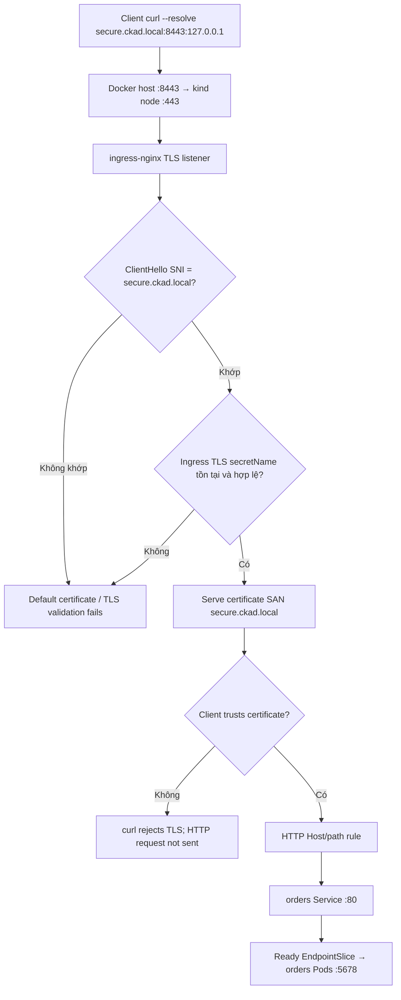
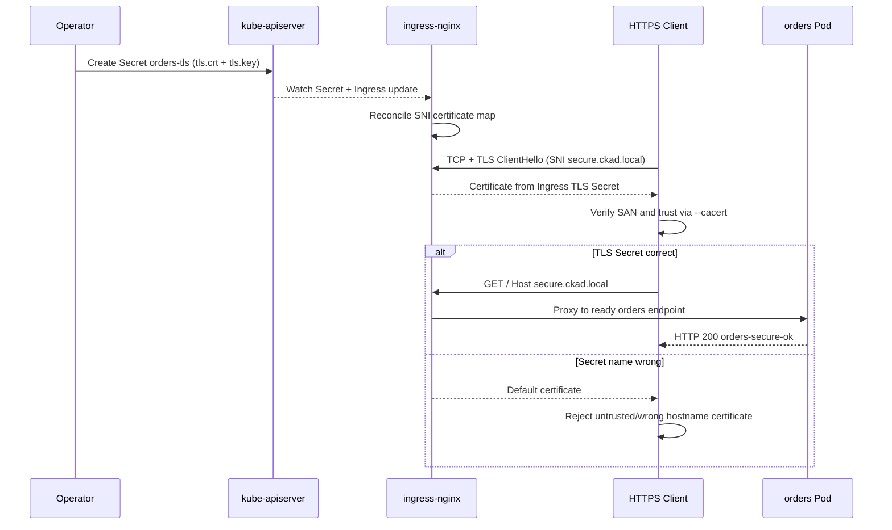

# D5-012 — Ingress TLS/SNI: HTTPS trả sai certificate dù HTTP vẫn khỏe

**Domain 5 · Services and Networking · CKAD · Advanced · Bài cuối roadmap**

## Tình huống production
Một cổng `secure.ckad.local` trả `orders-secure-ok` qua HTTP, Deployment 2/2 Ready, Service có EndpointSlice Ready. Tuy nhiên khách HTTPS gặp `SSL certificate problem`: Ingress trỏ `spec.tls[].secretName: legacy-tls` (Secret không tồn tại) thay vì `orders-tls`. ingress-nginx có thể dùng certificate mặc định nên TLS handshake vẫn diễn ra, nhưng **hostname/certificate verification thất bại**. Đây là lỗi ở TLS termination, không phải lỗi Service port, DNS nội bộ, routing path (D5-001..011).

## Kết quả cần đạt
- Tách biệt **DNS resolution → TLS SNI → Ingress TLS Secret → HTTP Host routing → Service → Pod**.
- Tạo TLS Secret từ certificate tự ký có SAN `DNS:secure.ckad.local` **không commit private key**.
- Sửa **chỉ** TLS Secret reference trong Ingress; giữ nguyên backend.
- Xác minh HTTPS bằng CA certificate tin cậy cục bộ qua `curl --cacert` (không dùng `-k`).
- Chạy negative test: đổi secretName về giá trị sai, grader phải FAIL rồi phục hồi.

## Sơ đồ quyết định TLS


## Sequence: API watch và TLS handshake


## Yêu cầu môi trường
Docker daemon, kind, kubectl, openssl, curl, bash; internet để tải image và ingress controller. Chạy trên **host** đang chạy Docker, không chạy `curl 127.0.0.1` từ container khác. Cluster và namespace riêng biệt. Ingress-nginx là controller riêng, không được mặc định giả định Ingress tự chạy.

```bash
kind create cluster --name ckad-d5-012 --config kind-config.yaml
kubectl config use-context kind-ckad-d5-012
kubectl apply -f https://raw.githubusercontent.com/kubernetes/ingress-nginx/controller-v1.12.1/deploy/static/provider/kind/deploy.yaml
kubectl -n ingress-nginx rollout status deployment/ingress-nginx-controller --timeout=300s
bash bootstrap.sh
kubectl -n ckad-d5-012 rollout status deployment/orders --timeout=180s
```

`bootstrap.sh` apply `setup.yaml`, tạo chứng chỉ ngắn hạn tự ký có SAN rồi tạo Secret `orders-tls`. Certificate và key nằm trong thư mục tạm `mktemp` và được xóa ngay sau khi tạo Secret; **không đưa private key vào Git**. Để kiểm tra client TLS, bootstrap xuất **public certificate** ra `./.lab-ca.crt` (gitignore cục bộ nếu cần; không commit file này). Dùng đúng file này khi chạy `verify.sh`. Chứng chỉ tự ký chỉ dùng cho lab, production dùng CA tin cậy và rotation phù hợp.

## Khảo sát trạng thái hỏng
```bash
kubectl -n ckad-d5-012 get ingress orders-gateway -o yaml
kubectl -n ckad-d5-012 get secret orders-tls
kubectl -n ckad-d5-012 get svc,endpointslice,pods
curl -sS --resolve secure.ckad.local:8080:127.0.0.1 http://secure.ckad.local:8080/
curl --cacert ./.lab-ca.crt --resolve secure.ckad.local:8443:127.0.0.1 https://secure.ckad.local:8443/
```
HTTP dự kiến trả `orders-secure-ok`; HTTPS dự kiến **FAIL** vì Ingress dùng Secret `legacy-tls`. Kiểm tra certificate được trình bày qua `openssl s_client -connect 127.0.0.1:8443 -servername secure.ckad.local -showcerts`; đừng nhầm TLS handshake thành HTTP success.

## Nhiệm vụ thi
1. Dùng `kubectl describe ingress` và `kubectl get secret` để xác định Secret reference sai.
2. Chỉ sửa `spec.tls[0].secretName` thành `orders-tls`, giữ host `secure.ckad.local` và backend `orders:80`.
3. Chờ controller đồng bộ, chạy `bash verify.sh`; giải thích tại sao curl **không dùng -k**.
4. Chạy `bash negative-tests.sh` để kiểm tra grader có phát hiện hồi quy và tự phục hồi.

## Solution / auto-grading
```bash
bash solution.sh
bash verify.sh
bash negative-tests.sh
```
`verify.sh` bắt buộc kiểm tra Kubernetes context, namespace, rollout, ready endpoints, TLS Secret type/cert/key, SAN, Ingress spec, **HTTPS thật** qua controller và HTTP body. Nó không PASS chỉ vì YAML đúng. `negative-tests.sh` có `trap` khôi phục khi script bị ngắt; nếu host mất điện giữa lúc sửa, chạy lại `solution.sh`. Không chạy trên cluster production.

## Troubleshooting
| Triệu chứng | Nguyên nhân / kiểm tra |
|---|---|
| Connection refused 8443 | Docker extraPortMappings / controller chưa Ready: `docker ps`, `kubectl -n ingress-nginx get pods` |
| HTTP OK, HTTPS certificate fail | TLS secretName sai, SAN sai hoặc CA không tin cậy: `kubectl describe ingress -n ckad-d5-012 orders-gateway` |
| `curl -k` OK nhưng `--cacert` FAIL | Bỏ qua validation chỉ che lỗi certificate; kiểm tra SNI và chain |
| 503 sau khi TLS thành công | EndpointSlice thiếu ready endpoint; `kubectl -n ckad-d5-012 get endpointslice` |
| Secret có nhưng vẫn default cert | `kubectl -n ingress-nginx logs deployment/ingress-nginx-controller`, kiểm tra namespace và tls.crt/tls.key |
| Host không match | Dùng `--resolve` để vừa định tuyến IP vừa giữ SNI và Host; đừng dùng `-H Host` với URL IP cho TLS |
| TLS chưa cập nhật ngay | Controller watch/reconcile bất đồng bộ; retry có timeout, không sleep vô hạn |

## Cleanup
```bash
kind delete cluster --name ckad-d5-012
rm -f ./.lab-ca.crt
```
Không xóa cluster của lab khác.

## Tài liệu chính thức
- [Kubernetes Ingress TLS](https://kubernetes.io/docs/concepts/services-networking/ingress/#tls)
- [Kubernetes TLS Secrets](https://kubernetes.io/docs/concepts/configuration/secret/#tls-secrets)
- [Ingress controllers](https://kubernetes.io/docs/concepts/services-networking/ingress-controllers/)
- [kind ingress guide](https://kind.sigs.k8s.io/docs/user/ingress/)
- [EndpointSlice](https://kubernetes.io/docs/concepts/services-networking/endpoint-slices/)
