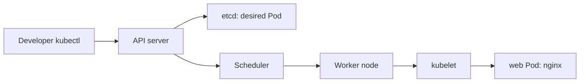
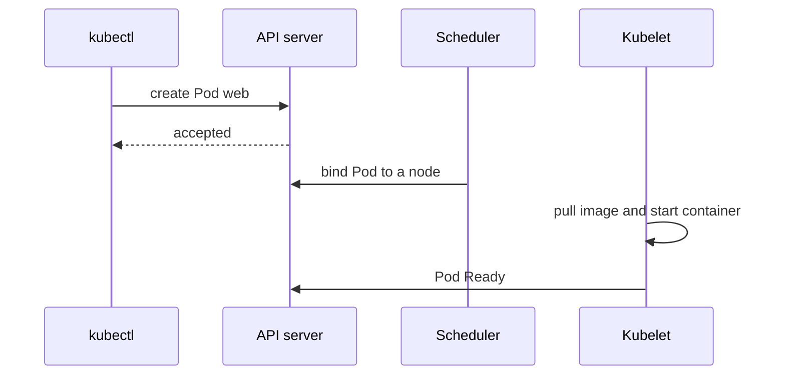

# CKAD-001 · Pod, Labels và Namespace

**Mức:** cơ bản → trung cấp · **Cluster:** kind (Kubernetes in Docker) · **Namespace:** ckad-001

## Mục tiêu và đề bài

Tạo Pod web, image nginx:1.27, hai labels app=web và tier=frontend, container web mở cổng 80.

## Vì sao concept này tồn tại?

Pod là đơn vị lập lịch; kubectl gửi PodSpec vào API server. Scheduler bind tới node, kubelet pull image rồi start container. Labels không tự định tuyến traffic: chúng là metadata để selector tìm đúng Pod.

## Diagram — cấu trúc và quan hệ



## Diagram — sequence và controller



## Thực hành

```bash
./env/kind/up.sh                  # chỉ dựng cluster một lần
./ckad start 001
kubectl --context kind-ckad-labs -n ckad-001 get all
kubectl --context kind-ckad-labs -n ckad-001 get events --sort-by=.lastTimestamp
# Thực hiện yêu cầu phía trên bằng YAML/kubectl
./ckad check 001
```

Giải bài trước khi đọc `solution.yaml`. Quan sát event, Pod status, deployment spec và log để lý giải hành vi; khi checker báo FAIL phải xác định controller chưa reconcile hay field YAML sai.

## Negative test và production troubleshooting

Đổi image thành nginx:tag-not-found, quan sát ErrImagePull rồi khôi phục.

Lưu ý: `kubectl apply` thành công **không đồng nghĩa** Pod đã Ready hoặc Service đã có EndpointSlice. Hãy phân biệt desired state và actual state.

## Tự đánh giá, lời giải và cleanup

```bash
./ckad hint 001
./ckad solve 001             # chỉ khi cần xem lời giải
./ckad check 001
./ckad reset 001             # chỉ xóa namespace bài này
```

Tra cứu: [Kubernetes Concepts](https://kubernetes.io/docs/concepts/) · [API reference](https://kubernetes.io/docs/reference/kubernetes-api/).
