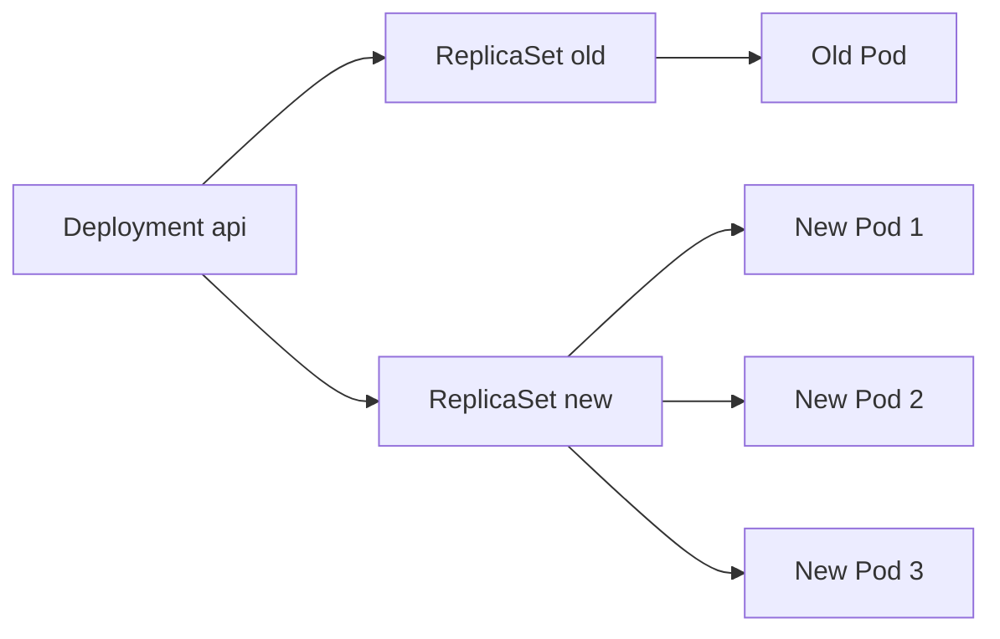
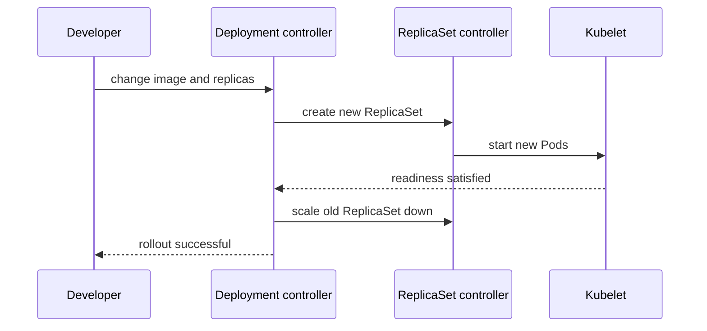

# CKAD-002 · Deployment, ReplicaSet và Rollout

**Mức:** cơ bản → trung cấp · **Cluster:** kind (Kubernetes in Docker) · **Namespace:** ckad-002

## Mục tiêu và đề bài

Scale Deployment api từ 1 lên 3 replicas, đổi nginx:1.27 sang nginx:1.29, đặt rollingUpdate maxSurge=1 và maxUnavailable=0.

## Vì sao concept này tồn tại?

Deployment controller tạo ReplicaSet, ReplicaSet controller tạo Pod. Rollout cần Pod mới Ready trước khi thu hẹp ReplicaSet cũ, giúp giảm nguy cơ gián đoạn.

## Diagram — cấu trúc và quan hệ



## Diagram — sequence và controller



## Thực hành

```bash
./env/kind/up.sh                  # chỉ dựng cluster một lần
./ckad start 002
kubectl --context kind-ckad-labs -n ckad-002 get all
kubectl --context kind-ckad-labs -n ckad-002 get events --sort-by=.lastTimestamp
# Thực hiện yêu cầu phía trên bằng YAML/kubectl
./ckad check 002
```

Giải bài trước khi đọc `solution.yaml`. Quan sát event, Pod status, deployment spec và log để lý giải hành vi; khi checker báo FAIL phải xác định controller chưa reconcile hay field YAML sai.

## Negative test và production troubleshooting

Đổi image thành tag không tồn tại; theo dõi rollout stuck và thử kubectl rollout undo.

Lưu ý: `kubectl apply` thành công **không đồng nghĩa** Pod đã Ready hoặc Service đã có EndpointSlice. Hãy phân biệt desired state và actual state.

## Tự đánh giá, lời giải và cleanup

```bash
./ckad hint 002
./ckad solve 002             # chỉ khi cần xem lời giải
./ckad check 002
./ckad reset 002             # chỉ xóa namespace bài này
```

Tra cứu: [Kubernetes Concepts](https://kubernetes.io/docs/concepts/) · [API reference](https://kubernetes.io/docs/reference/kubernetes-api/).
