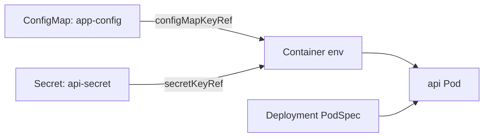
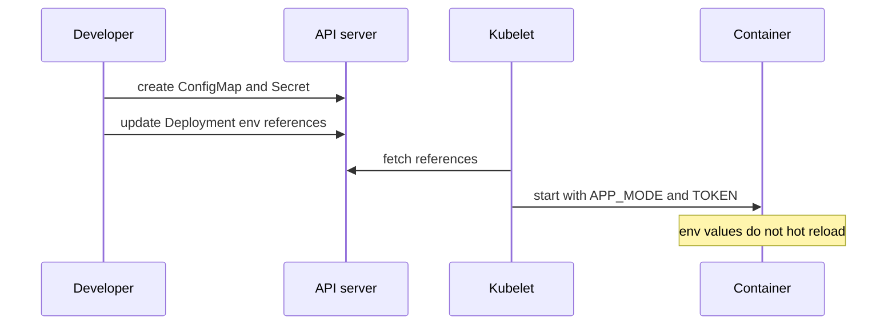

# CKAD-003 · ConfigMap, Secret và Environment

**Mức:** cơ bản → trung cấp · **Cluster:** kind (Kubernetes in Docker) · **Namespace:** ckad-003

## Mục tiêu và đề bài

Tạo ConfigMap app-config APP_MODE=production, Secret api-secret TOKEN=training-only, sửa Deployment api để lấy hai env qua valueFrom.

## Vì sao concept này tồn tại?

ConfigMap dành cho cấu hình không nhạy cảm; Secret vẫn cần RBAC/at-rest encryption vì base64 không phải encryption. Env variables được snapshot khi tạo container.

## Diagram — cấu trúc và quan hệ



## Diagram — sequence và controller



## Thực hành

```bash
./env/kind/up.sh                  # chỉ dựng cluster một lần
./ckad start 003
kubectl --context kind-ckad-labs -n ckad-003 get all
kubectl --context kind-ckad-labs -n ckad-003 get events --sort-by=.lastTimestamp
# Thực hiện yêu cầu phía trên bằng YAML/kubectl
./ckad check 003
```

Giải bài trước khi đọc `solution.yaml`. Quan sát event, Pod status, deployment spec và log để lý giải hành vi; khi checker báo FAIL phải xác định controller chưa reconcile hay field YAML sai.

## Negative test và production troubleshooting

Đặt key ConfigMap thành MISSING và quan sát Pod bị CreateContainerConfigError.

Lưu ý: `kubectl apply` thành công **không đồng nghĩa** Pod đã Ready hoặc Service đã có EndpointSlice. Hãy phân biệt desired state và actual state.

## Tự đánh giá, lời giải và cleanup

```bash
./ckad hint 003
./ckad solve 003             # chỉ khi cần xem lời giải
./ckad check 003
./ckad reset 003             # chỉ xóa namespace bài này
```

Tra cứu: [Kubernetes Concepts](https://kubernetes.io/docs/concepts/) · [API reference](https://kubernetes.io/docs/reference/kubernetes-api/).
