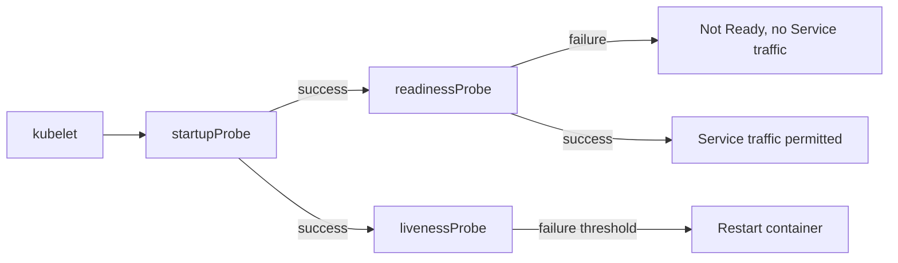
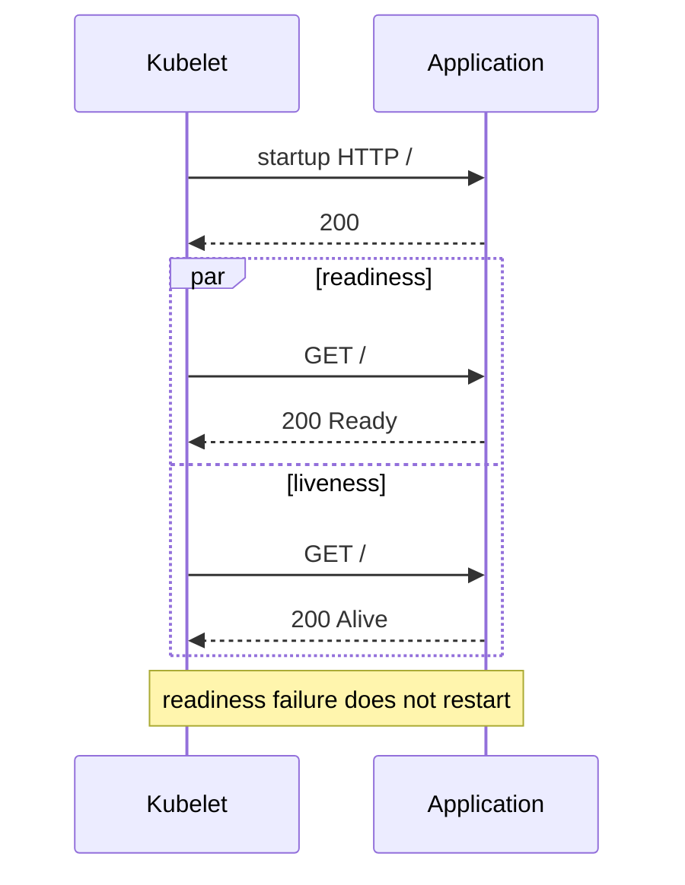

# CKAD-004 · Startup, Readiness, Liveness probes

**Mức:** cơ bản → trung cấp · **Cluster:** kind (Kubernetes in Docker) · **Namespace:** ckad-004

## Mục tiêu và đề bài

Sửa readiness path /missing thành / trên port 80; bổ sung startupProbe và livenessProbe HTTP / port 80.

## Vì sao concept này tồn tại?

Readiness thất bại làm Pod không Ready, không restart. Liveness thất bại liên tục gây restart. Startup trì hoãn hai probe kia cho đến khi app khởi động thành công.

## Diagram — cấu trúc và quan hệ



## Diagram — sequence và controller



## Thực hành

```bash
./env/kind/up.sh                  # chỉ dựng cluster một lần
./ckad start 004
kubectl --context kind-ckad-labs -n ckad-004 get all
kubectl --context kind-ckad-labs -n ckad-004 get events --sort-by=.lastTimestamp
# Thực hiện yêu cầu phía trên bằng YAML/kubectl
./ckad check 004
```

Giải bài trước khi đọc `solution.yaml`. Quan sát event, Pod status, deployment spec và log để lý giải hành vi; khi checker báo FAIL phải xác định controller chưa reconcile hay field YAML sai.

## Negative test và production troubleshooting

Sửa readiness thành /missing nhưng giữ liveness đúng; chứng minh container không restart do readiness.

Lưu ý: `kubectl apply` thành công **không đồng nghĩa** Pod đã Ready hoặc Service đã có EndpointSlice. Hãy phân biệt desired state và actual state.

## Tự đánh giá, lời giải và cleanup

```bash
./ckad hint 004
./ckad solve 004             # chỉ khi cần xem lời giải
./ckad check 004
./ckad reset 004             # chỉ xóa namespace bài này
```

Tra cứu: [Kubernetes Concepts](https://kubernetes.io/docs/concepts/) · [API reference](https://kubernetes.io/docs/reference/kubernetes-api/).
