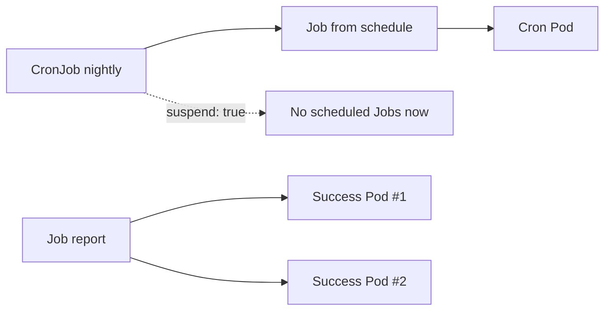
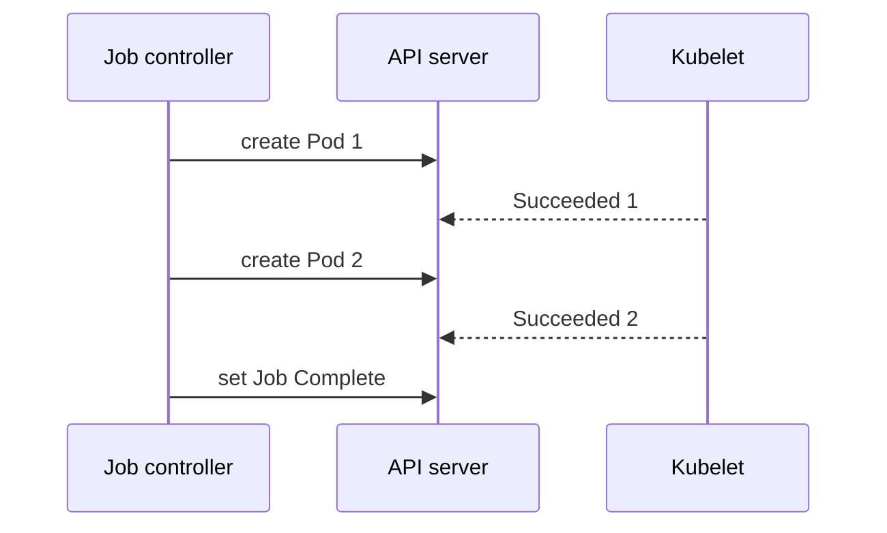

# CKAD-005 · Job và CronJob

**Mức:** cơ bản → trung cấp · **Cluster:** kind (Kubernetes in Docker) · **Namespace:** ckad-005

## Mục tiêu và đề bài

Tạo Job report hoàn thành 2 lần với parallelism=1; CronJob nightly lịch */5 * * * *, concurrencyPolicy=Forbid, suspend=true.

## Vì sao concept này tồn tại?

Job controller tạo Pod đến khi đủ completions; CronJob controller tạo Job theo lịch. suspend=true ngăn việc tạo thêm Job tự động trong lúc học.

## Diagram — cấu trúc và quan hệ



## Diagram — sequence và controller



## Thực hành

```bash
./env/kind/up.sh                  # chỉ dựng cluster một lần
./ckad start 005
kubectl --context kind-ckad-labs -n ckad-005 get all
kubectl --context kind-ckad-labs -n ckad-005 get events --sort-by=.lastTimestamp
# Thực hiện yêu cầu phía trên bằng YAML/kubectl
./ckad check 005
```

Giải bài trước khi đọc `solution.yaml`. Quan sát event, Pod status, deployment spec và log để lý giải hành vi; khi checker báo FAIL phải xác định controller chưa reconcile hay field YAML sai.

## Negative test và production troubleshooting

Thử suspend=false ở CronJob, quan sát lịch chạy và đổi lại true để tránh tích tụ workload.

Lưu ý: `kubectl apply` thành công **không đồng nghĩa** Pod đã Ready hoặc Service đã có EndpointSlice. Hãy phân biệt desired state và actual state.

## Tự đánh giá, lời giải và cleanup

```bash
./ckad hint 005
./ckad solve 005             # chỉ khi cần xem lời giải
./ckad check 005
./ckad reset 005             # chỉ xóa namespace bài này
```

Tra cứu: [Kubernetes Concepts](https://kubernetes.io/docs/concepts/) · [API reference](https://kubernetes.io/docs/reference/kubernetes-api/).
