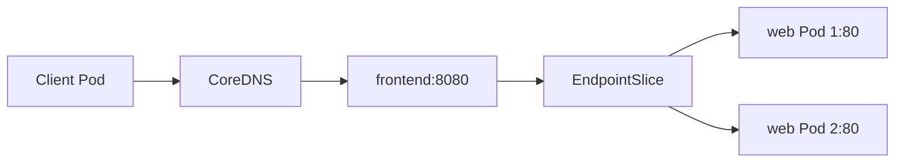
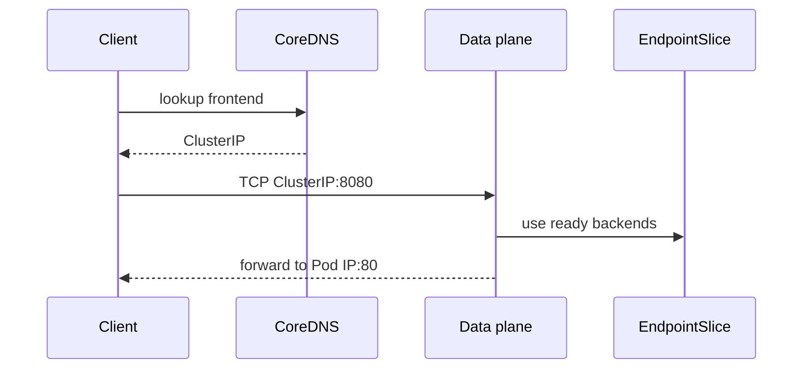

# CKAD-006 · Service, DNS và EndpointSlice

**Mức:** cơ bản → trung cấp · **Cluster:** kind (Kubernetes in Docker) · **Namespace:** ckad-006

## Mục tiêu và đề bài

Tạo ClusterIP Service frontend port 8080 -> targetPort 80, selector app=web, cho Deployment web hai replicas.

## Vì sao concept này tồn tại?

Service là abstraction endpoint ổn định, selector tìm Pod; EndpointSlice lưu danh sách IP Pod đủ điều kiện. CoreDNS phân giải tên frontend, data plane route đến backend.

## Diagram — cấu trúc và quan hệ



## Diagram — sequence và controller



## Thực hành

```bash
./env/kind/up.sh                  # chỉ dựng cluster một lần
./ckad start 006
kubectl --context kind-ckad-labs -n ckad-006 get all
kubectl --context kind-ckad-labs -n ckad-006 get events --sort-by=.lastTimestamp
# Thực hiện yêu cầu phía trên bằng YAML/kubectl
./ckad check 006
```

Giải bài trước khi đọc `solution.yaml`. Quan sát event, Pod status, deployment spec và log để lý giải hành vi; khi checker báo FAIL phải xác định controller chưa reconcile hay field YAML sai.

## Negative test và production troubleshooting

Sửa selector app=unknown, xác minh EndpointSlice không còn backend, rồi sửa selector về app=web.

Lưu ý: `kubectl apply` thành công **không đồng nghĩa** Pod đã Ready hoặc Service đã có EndpointSlice. Hãy phân biệt desired state và actual state.

## Tự đánh giá, lời giải và cleanup

```bash
./ckad hint 006
./ckad solve 006             # chỉ khi cần xem lời giải
./ckad check 006
./ckad reset 006             # chỉ xóa namespace bài này
```

Tra cứu: [Kubernetes Concepts](https://kubernetes.io/docs/concepts/) · [API reference](https://kubernetes.io/docs/reference/kubernetes-api/).
